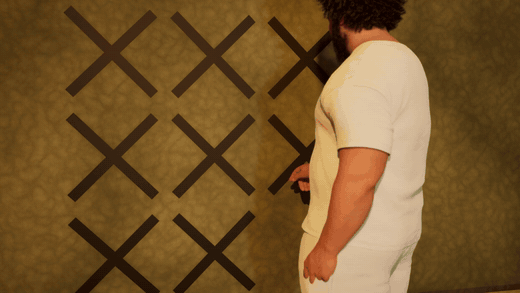
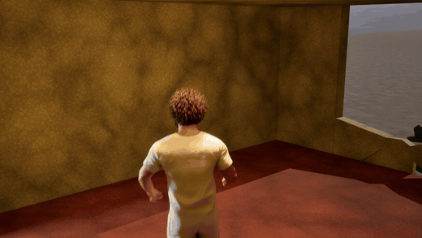
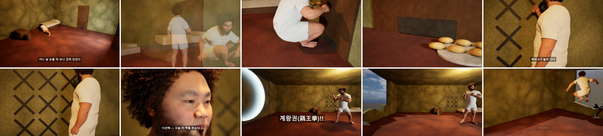
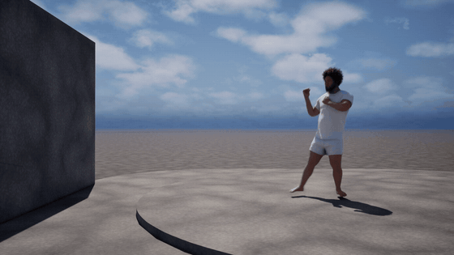
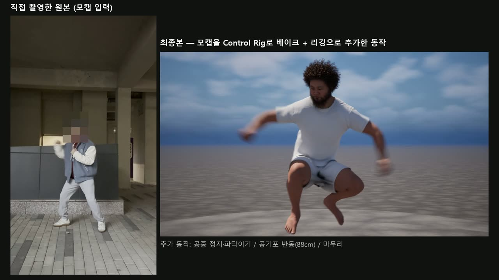

# 갇힌 남자 —「올드보이」 오마주 · 마커리스 모캡 + 리깅 + 물리 시네마틱 (Unreal Engine 5.8)

> 내 동작을 스마트폰으로 직접 찍어(클립 7개) 메타휴먼에게 입히고, Control Rig로 동작을 더하고, Chaos 물리로 벽을 부수는 **3분 22초짜리 단편**입니다.
> 밀실에 15년 갇혀 군만두만 먹던 남자가 수련 끝에 주먹으로 벽을 부수고, 닭처럼 파닥이며 날아서 탈출합니다.
> 대학 Extended Reality 수업 과제 1 · 1인 제작 · 2026.10–11

| 세월이 흐름 (벽의 X 표시) | 탈출 (리깅으로 만든 닭 날갯짓) |
|:---:|:---:|
|  |  |

▶ **전체 영상 (3분 22초, 720p, 소리 포함)**: [media/oldboy_720p.mp4](media/oldboy_720p.mp4)



## 확장판 「갇힌 남자」

처음 낸 11초짜리 클라이맥스(아래 「Air Cannon Punch」)를 바탕으로, "3~5분 분량의 스토리텔링"이라는 조건에 맞춰 이야기를 늘렸습니다. 원작 영상·음악은 쓰지 않고 설정만 빌려 왔습니다.

| 막 | 내용 | 쓴 기술 |
|---|---|---|
| 1. 갇힘 | 바닥에서 깨어나 뒤척이다 일어나고, 문을 두드린다 | 모캡(깨어나기·문 두드리기) + 액터 회전 키로 누운 자세 |
| 2. 군만두 | 배식구로 쟁반이 들어오고, 손으로 집어 먹는다 | 모캡(먹기) + 쟁반을 손 본에 붙이는 Attach 트랙 |
| 3. 세월 | 벽에 X를 긋는다. 1일째 → 1년째 → 15년째 자막 | 모캡(긋기) + 획마다 Scale 키로 그려지는 X |
| 4. 첫 실패 | 벽을 쳤다가 손이 아파 움켜쥔다 | 모캡(펀치 실패) |
| 5. 수련 | TV 앞 섀도복싱, 먹기·긋기와 섞어 반복하며 시간이 흐른다 | 모캡(섀도복싱), 반복마다 다른 카메라 앵글 |
| 6. 각성 | 점프 → 공중 정지·기 모으기 → 스트레이트 → 공기포 → 벽 붕괴 | 클라이맥스(리깅 가산 레이어 + Chaos Destruction) |
| 7. 탈출 | 양팔을 파닥이며 벽 구멍으로 날아 나간다 | Control Rig 가산 키로 비행 경로·날갯짓을 새로 만듦 |

**확장판에서 더한 것**
- **직접 촬영한 모캡 7개**(깨어나기, 문 두드리기, 먹기, X 긋기, 펀치 실패, 섀도복싱, 펀치). 아이폰 HLG HDR 영상은 Live Link Hub가 읽지 못해서 ffmpeg로 8비트 SDR·59.94fps 고정으로 다시 인코딩했습니다.
- **밀실 세트**: 침대·TV(깜빡이는 Unlit 머티리얼 + RectLight)·문과 배식구·식탁, 천장 전구 하나. 벽이 부서지면 바깥 햇빛이 구멍으로 들어오고 조각이 역광 실루엣이 되도록 태양 방향을 맞췄습니다.
- **시퀀스 `LS_Room`**(5127프레임, 컷 20여 개) + 클라이맥스 `LS_Punch`(탈출 포함 478프레임)를 Movie Render Queue로 렌더하고, Python 스크립트(`Tools/story/make_story.py`)로 방 효과음 합성·자막·제목/엔딩 카드·이어 붙이기를 한 번에 합니다.

**확장판에서 해결한 문제**
- **누운 자세**: 단안 모캡은 바닥에 누운 자세를 제대로 풀지 못해서 거의 선 자세로 나왔습니다. 곧게 선 프레임 하나를 고정하고 액터 자체를 회전 키로 눕혀 뒤척이게 한 다음, 컷이 바뀌는 순간 원래 모캡으로 넘겼습니다.
- **쟁반 들기**: 쟁반을 `hand_l` 소켓에 붙이는 Attach 트랙을 썼는데, MRQ에서는 붙기 전 구간에서 Transform 키대로 움직이지 않았습니다. 배식구로 들어오는 쟁반과 손에 드는 쟁반을 별도 액터로 나눠 해결했습니다.
- **트랙이 겹쳐 값이 평균이 됨**: 시퀀스에 액터를 넣을 때 자동으로 생기는 Transform 트랙과 새로 만든 트랙이 섞여 위치가 절반만 움직였습니다. 자동 트랙을 찾아 지우는 절차를 정리했습니다.
- **같이 재생되는 시퀀스**: 테스트용으로 켜 둔 레벨 시퀀스 자동 재생 때문에 방 장면을 렌더할 때 클라이맥스가 함께 재생되었습니다. 렌더 전에 자동 재생을 끄도록 했습니다.

---

## 클라이맥스: Air Cannon Punch (첫 제출본, 11초)

> 확장판 6막에 들어간 장면입니다. 처음에는 이것만 따로 냈습니다.

| 공중 정지 · 기 모으기 (리깅으로 추가) | 공기포 · 반동 · 벽 붕괴 |
|:---:|:---:|
|  |  |

▶ **전체 영상 (720p, 소리 포함)**: [media/punch_final_720p.mp4](media/punch_final_720p.mp4)
▶ **촬영 원본 ↔ 최종본 비교**: [media/punch_compare_720p.mp4](media/punch_compare_720p.mp4) (공개 저장소라 원본의 얼굴은 자동 추적 모자이크로 가렸습니다)



---

### 무엇을 만들었나

과제 조건은 "카메라 모션 캡처 → 3D 캐릭터 → 리타게팅 → 리깅 → 피직스/인터랙션"을 모두 거쳐 하나의 이야기를 만드는 것이었습니다. 저는 **"주먹을 내지르면 공기포가 나가 벽이 무너진다"**는 이야기로 정했습니다.

1. 사우스포 자세로 대치
2. 점프한 뒤 **공중에서 멈춰** 양팔을 펴고 파닥이며 기를 모은다 (모캡에는 없는 동작. 리깅으로 만듦)
3. 떨어지며 스트레이트를 뻗고, 주먹에서 공기포가 나간다
4. 쏜 반동으로 몸이 **88cm 뒤로 밀린다** (리깅으로 만든 물리적 반응)
5. 공기포가 닿는 프레임에 벽이 48조각으로 부서진다 (Chaos Destruction)
6. 등 뒤 카메라로 무너진 벽을 보며 마무리

### 파이프라인

```
스마트폰 촬영 (직접 촬영, 59.94fps)
  → Live Link Hub Capture Manager로 가져오기
  → MetaHuman Performance: 마커리스 바디 트래킹 → Performer Skeleton 애니메이션
  → IK Retargeter: 내가 만든 메타휴먼(MH_Puncher)으로 리타게팅
  → Sequencer: 구간 나누기로 점프 꼭대기에서 시간 정지
  → Control Rig에 키프레임 베이크 (스켈레톤을 리깅이 직접 움직이게 함)
  → 가산(Additive) 섹션: 공중 파닥임 · 공기포 반동 · 마무리 동작을 키프레임으로 추가
  → 공기포: 메시 + Fresnel 머티리얼 + Transform 키 / 벽: Geometry Collection + Field System
  → 카메라 6대 컷 편집, 슬로모션(0.35배), 충돌 카메라 흔들림
  → Movie Render Queue (1080p, 템포럴 샘플 8)
  → Python(numpy)으로 효과음을 직접 합성 → ffmpeg로 소리 합치기·비교 영상 만들기
```

## 사용 기술

| 분야 | 사용한 것 |
|---|---|
| 엔진 | Unreal Engine 5.8 (Blueprint 전용) |
| 모션 캡처 | MetaHuman Animator 마커리스 바디 트래킹 (단안 영상) |
| 캐릭터 | MetaHuman Creator → Assemble (UE Cinematic) |
| 애니메이션 | IK Rig / IK Retargeter, Sequencer, **Control Rig 베이크 + 가산 레이어** |
| 물리 | Chaos Destruction (Voronoi Fracture), Field System (Cluster Strain, Linear Velocity) |
| 연출 | CineCamera 6대, Camera Cut, Time Dilation(슬로모션), Movie Render Queue |
| 블루프린트 | 벽 붕괴 트리거 `BP_WallBreaker`, 시네마틱 전용 GameMode |
| 도구 자동화 | **Claude Code + Unreal MCP**(에디터 조작), Python(numpy·PIL), ffmpeg, Bash |

### 해결한 문제

**1. 시간 정지를 넣으면 다른 이벤트 타이밍이 모두 어긋남**
점프 꼭대기에서 2초 동안 멈추도록 애니메이션 섹션을 나누자 착지·펀치·공기포·벽 붕괴 프레임이 모두 밀렸습니다. 모캡 원본에서 이륙·최고점·착지·주먹 최대 프레임을 먼저 측정해 두고, 시퀀스 기준 프레임으로 다시 계산해 공기포 키와 벽 붕괴 시점을 맞췄습니다.

**2. PIE와 렌더에서 벽이 부서지는 시점이 0.25초 다름**
처음에는 레벨에 둔 액터가 BeginPlay 후 타이머로 벽을 터뜨렸습니다. 그런데 Movie Render Queue는 PIE와 시작 시점이 달라서 렌더 영상에서는 공기포가 닿기 전에 벽이 깨졌습니다. 벽 붕괴 액터를 시퀀스의 **Spawnable**로 바꾸고 Spawn 트랙의 184프레임 키로 생성되게 했습니다. 그래서 PIE와 렌더가 같은 프레임에 부서집니다.

**3. 교수님 피드백: "애니메이션 트랙 재생이 아니라 리깅이 스켈레톤을 움직이게 하라"**
v1은 모캡을 애니메이션 트랙으로 재생하고 그 위에 리그를 얹었습니다. v2에서는 편집된 동작 전체를 하나의 애니메이션으로 내보내 Control Rig에 베이크하고, 추가 동작은 같은 트랙의 가산 섹션에 넣었습니다. 59.94fps 애니메이션은 30fps 시퀀스에서 내보낼 때 "호환되지 않는 프레임 레이트" 오류가 나서, 표시 프레임레이트를 잠시 바꿔 내보내는 방법으로 해결했습니다.

**4. 리그 컨트롤 축이 문서화되어 있지 않음**
반동을 넣을 때 `body_ctrl`·발 IK 컨트롤이 월드 어느 방향으로 움직이는지 직접 측정했습니다. 오른발 IK는 왼발과 축 부호가 반대여서, 같은 값을 넣으면 다리가 벌어졌습니다. 컨트롤마다 축을 표로 정리한 뒤 반동 키를 넣었습니다(발은 1프레임 늦게 따라와 미끄러지는 느낌을 줌).

**5. 버그처럼 보이는 연출 걷어내기**
처음 넣은 "기 모으며 몸 떨기"는 교수님께서 애니메이션 버그로 오해할 수 있다고 하셨습니다. 그래서 떨림을 없애고, 크고 분명한 팔 파닥임(점점 빨라짐)으로 바꿨습니다.

## Claude Code + Unreal MCP로 자동화한 부분

수업에서 권장한 대로, AI 코딩 에이전트(Claude Code)를 MCP로 에디터에 연결해서 반복 작업을 맡겼습니다.

- 액터 배치·속성 설정, 시퀀서 트랙·섹션·키프레임 생성 (반동 키, 카메라 흔들림, 공기포 Transform 등)
- 한국어 에디터에서 Blueprint 노드를 스크립트로 만들기 (`BP_WallBreaker`)
- Simulate를 켜고 정해진 시각에 뷰포트를 캡처해 리깅 결과를 자동으로 확인
- 효과음 합성(`Tools/sfx/make_sfx.py`), 렌더 이미지와 소리 합치기(`mux.sh`), 비교 영상 만들기(`make_compare.sh`), 얼굴 모자이크(`anonymize_face.py`), 기술 문서 생성(`Docs/make_tech_doc.py`)

에셋 생성처럼 MCP로 할 수 없는 작업(Fracture, MetaHuman Performance 처리, 리타게터 생성)은 제가 에디터 UI에서 직접 했습니다. 작업 중 알게 된 MCP 사용법과 엔진 동작은 [`CLAUDE.md`](CLAUDE.md)에 정리했습니다.

## 저장소 구성

| 경로 | 내용 |
|---|---|
| `Project1/` | UE 5.8 프로젝트 (`Content/Story`, `Content/Cinematics/LS_Room`·`LS_Punch`) |
| `Tools/story/` | 확장판 최종 편집(방 효과음·자막·카드·이어 붙이기) |
| `Tools/sfx/` | 효과음 합성, 소리 합치기, 비교 영상, 얼굴 모자이크 스크립트 |
| `Docs/` | 기술 요소 정리 문서(.docx)와 생성 스크립트 |
| `media/` | README용 미리보기 영상·GIF |

> MetaHuman 에셋과 촬영 원본은 용량과 개인정보 문제로 저장소에 넣지 않았습니다. 프로젝트를 열어도 캐릭터는 없습니다.
